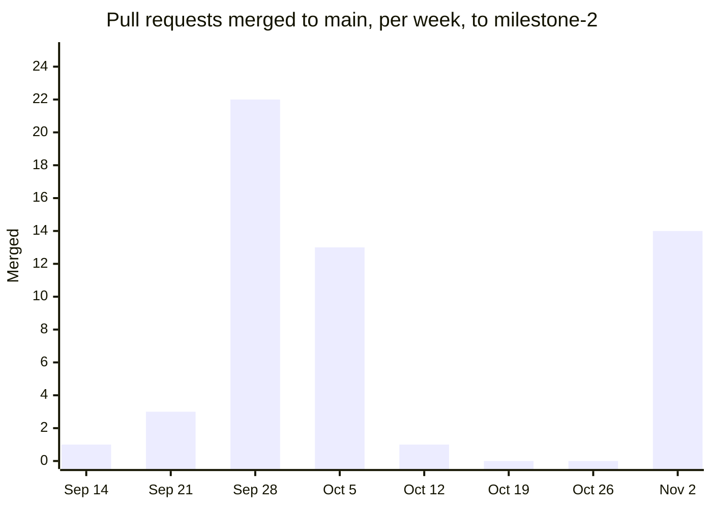

# Metrics report

Milestone 3 asks for "a metrics report covering coverage trends, a code-quality
indicator, and deployment frequency." This report measures each, at each
milestone, with the method written down so any number can be re-measured.
Tracked in #121.

**Data points.** `milestone-1` (`1eca04e`, September 30), the coverage
baseline (`963dd2e`, October 12, from [`coverage.md`](../testing/coverage.md)),
and `milestone-2` (`596bd35`, November 2). `v1.0.0` is added at the end of
Milestone 3 (#125).

*Measured November 3, 2026.*

## 1. Coverage trend

Unit-test coverage, measured the same way at every point:
`vitest run --coverage` with the V8 provider, over `src/**` without the test
files, the integration tests or the test helpers. Coverage tooling arrived
with #62 on October 12, so the `milestone-1` row was measured afterwards by
checking out that tag and running the same command with the same
`@vitest/coverage-v8` 2.1.9 (method in §5).

Statements, with branches in brackets:

| Area | `milestone-1` (Sep 30) | Baseline (Oct 12) | `milestone-2` (Nov 2) | Target |
|---|---|---|---|---|
| **Server, all files** | 73.4% (94.7%) | 74.5% (94.5%) | 74.1% (94.7%) | 70% |
| Server services | 99.3% (98.3%) | 99.3% (98.4%) | 99.4% (98.5%) | 95% |
| Server routes | 100% (87.7%) | 100% (87.7%) | 100% (89.2%) | 95% |
| Server middleware | 77.0% (72.4%) | 86.0% (80.4%) | 88.6% (80.8%) | 80% |
| Server repositories (mocked) | 9.0% | 9.0% | 7.8% | none |
| **Client, all files** | 7.0% (77.3%) | 7.0% (77.3%) | **56.9%** (75.4%) | 50% |
| Client `src/lib`, except `api.ts` | 100% (98.5%) | 100% (98.5%) | 100% (98.4%) | 95% |
| Client pages, components, auth | 0% (5%) | 0% (5%) | **54.7%** (67.0%) | none yet |

**Integration coverage**, measured for the first time here, at `milestone-2`
(the 33 integration tests against PostgreSQL):

| Area | Statements | Branches |
|---|---|---|
| All server files | 78.0% | 73.3% |
| **Repositories** | **91.7%** | 85.7% |
| Services | 81.5% | 71.6% |
| Routes | 96.2% | 86.2% |
| Middleware | 77.5% | 54.7% |

**What the trend shows**
- **The money logic never dropped.** Server services and the client's
  `src/lib` (cents, splits, "you owe" wording) were near 100% at Milestone 1,
  and stayed there while the code around them grew (§2).
- **The client's jump** from 7% to 57% is the component tests (#76, #112).
  Before them, no screen was tested at all.
- **Middleware rose** from 77% to 89% with the rate limit (#71), which came
  with its own tests, and the security headers (#103).
- **Repository unit coverage fell** from 9.0% to 7.8%. That's expected, not a
  regression: the unit tests mock repositories by design (ADR-001), so every
  new query (editing, deleting, revoking) adds uncovered lines there. The
  integration tests cover the same files at **91.7%**. `coverage.md` said that
  would be measured at Milestone 3, and this is that measurement.

## 2. Code-quality indicators

### Size and tests

| | `milestone-1` | `milestone-2` | Change |
|---|---|---|---|
| Server: code lines (non-test) | 2,780 in 36 files | 3,261 in 38 files | +17% |
| Client: code lines (non-test) | 2,552 in 25 files | 3,456 in 32 files | +35% |
| Server unit tests | 408 | 483 | +75 |
| Server integration tests | 0 | 33 | +33 |
| Client tests | 91 | 157 | +66 |
| **All automated tests** | **499** | **673** | +35% |
| Server unit tests per 100 code lines | 14.7 | 14.8 | flat |
| Client tests per 100 code lines | 3.6 | 4.5 | up |

"Code lines" are non-blank lines that aren't comments, in `src/`, without the
test files.

### Cyclomatic complexity

ESLint's `complexity` rule, run over every non-test function at both tags
with the same configuration (method in §5). Complexity counts the
independent paths through a function; around 10 is a common point at which a
function becomes hard to test fully.

| | Functions | Mean | Median | Max | Over 10 |
|---|---|---|---|---|---|
| Server, `milestone-1` | 268 | 1.87 | 1 | 13 | 2 |
| Server, `milestone-2` | 317 | 1.92 | 1 | 13 | 2 |
| Client, `milestone-1` | 178 | 2.75 | 1 | 22 | 6 |
| Client, `milestone-2` | 248 | 2.73 | 1 | **33** | 7 |

**The server stayed flat:** 49 more functions, the same mean, and no new
function over 10. The two over 10 are `updateChore` (13) and `netOwed` (11),
both unchanged since Milestone 1.

**The client's maximum rose, in one place:** `ExpenseForm` in
`client/src/pages/AddExpensePage.tsx` went from **20 to 33**. #98 (editing an
expense) reused the Add expense form, and each field's starting value now
branches on "editing or adding". It works and is tested through its helper
(`lib/expenseForm.ts`), but it's now the most complex function in the
project. Splitting the starting values out of the component is the obvious
refactor. The other client functions over 10 are `buildDraft` (22), the same
form's validation, unchanged, and five more between 11 and 14.

### Enforced checks

These are pass-or-fail in CI rather than trends, so they read the same at
every point since they were introduced:

| Check | Since | Result at `milestone-2` |
|---|---|---|
| TypeScript errors, server and client | Milestone 1 (CI since #81) | 0 |
| ESLint findings, client | Milestone 1 (CI since #81) | 0 |
| ESLint findings, server, including the ADR-001 layering rules | #84, October 7 | 0 |
| Coverage targets met (§1) | #94, October 14 | All met |

### Dependency advisories in production code

From [`dependency-audit.md`](../security/dependency-audit.md), server
production dependencies (`npm audit --omit=dev`); the client had none at any
point:

| Date | Advisories | Note |
|---|---|---|
| September 9 | 6 | At the scaffold (#24) |
| October 7 | 8 (1 critical) | `proxy-addr` and `fast-uri` added |
| October 21 | 9 → **0** | `npm audit fix`, no major upgrade (#103) |

Seven development-only advisories remain in each workspace, through Vitest 2
(#101). None ship.

### CI health on `main`

26 CI runs on `main` (to November 3). **21 passed** and **4 were cancelled**,
because a newer push superseded them. **1 failed**, on October 9, and not on
code: Docker Hub refused to supply the PostgreSQL image (fixed in #89). **No CI
run on `main` has failed on its tests or checks**; the cancelled ones were
superseded by a newer commit, whose run passed. On pull requests: 45 passed, 2 failed
before merging (#95's image pull, and #112's mock after #105 merged), and 17
were superseded.

## 3. Deployment frequency

**To complete once CD runs (#118).** The application isn't deployed yet: the
first deployment is due November 10 (#117), and CD is due November 12. Until
then, the frequency is zero.

**What will be measured, and how:**
- **Deployments per week:** the successful runs of the CD deploy job on
  `main`, from the first deployment to `v1.0.0`, counted per week as in §4's
  chart.
- **Failed deployments:** deploy-job runs that failed, or deployed and then
  failed the health check.
- **Lead time:** from a pull request's merge to its deployment, which CD
  should make minutes, not days.

## 4. How work flowed

The same question as deployment frequency, asked of the work before it could
be deployed: how often did finished work reach `main`?

| | Milestone 1 | Milestone 2 |
|---|---|---|
| Pull requests merged | 26 (Agustin 15, Orlando 11) | 28 (Agustin 15, Orlando 13) |
| Approved by the other member | 17 of 26 | **28 of 28** |
| Merged by their own author | 4 (#35, #41, #50, #52) | **0** |
| Open → first review, median | 1.3 h | 0.8 h |
| Open → merge, median | 2.3 h | 0.8 h |
| Open → merge, slowest tenth | 9.7 days or more | **20.9 days** or more |
| Days with at least one merge | 6 | 4 |
| Merged in the last 3 days before the due date | 22 of 26 (85%) | 14 of 28 (50%), all on the due date |

Merged pull requests per week:



**What it shows**
- **Review became universal.** In Milestone 1, 4 pull requests merged without
  the other member's review. Branch protection (#80, October 7) made that
  impossible, and in Milestone 2 every one was approved by the other member.
- **The median hides the problem.** A median under an hour says most pull
  requests were reviewed as soon as both members were working on the project
  together. The slowest tenth waited three weeks.
- **Work arrived in bursts.** Both milestones merged most of their work at the
  end: the week of September 28, and the due date on November 2, after two
  weeks with nothing merged. That is the pattern behind the risk register's
  risks 2 and 16.

## 5. Method

Everything above can be re-measured from the repository. The scripts are in
[`scripts/metrics/`](../../scripts/metrics/).

- **Coverage at a tag:** check the tag out in a separate worktree
  (`git worktree add ../rs-m1 milestone-1`), `npm ci` in each workspace
  (`npx prisma generate` in `server/`), add the coverage provider without
  saving it if the tag predates it (`npm install --no-save
  @vitest/coverage-v8@2.1.9`), then:
  ```bash
  npx vitest run --coverage --coverage.provider=v8 --coverage.include="src/**/*.ts" --coverage.exclude="src/**/*.test.ts" --coverage.exclude="src/integration/**" --coverage.reporter=json-summary
  ```
  in `server/` (in `client/`, include `src/**/*.{ts,tsx}` and also exclude
  `src/test/**`). Areas are summed from `coverage/coverage-summary.json` by
  path.
- **Integration coverage:** the same flags, with
  `--config vitest.integration.config.ts --testTimeout=60000` and the Docker
  database running. Instrumentation slows the 500-expense check past the
  default 5-second timeout.
- **Size and complexity:** copy each tag's `src/` into `server/cx/<label>/`
  without test files, then run `complexity.config.mjs`,
  `complexity-summary.js` and `complexity-top.js` as their headers describe.
- **Pull requests:** `gh pr list --state merged --json …` (the fields are in
  `pr-flow.js`'s header), then `pr-flow.js` and `merges-per-week.js`. A pull
  request belongs to the milestone whose tag commit it merged on or before.
  #108, which merged into another branch, is left out; #113 re-applied it.
- **CI health:** `gh run list --workflow ci.yml --branch main` and the same
  without `--branch` for pull requests.

**Caveats**
- The `milestone-1` coverage row is retroactive: the code is the tag's, the
  measuring tool is from October.
- Complexity and line counts are of source as written, not compiled output.
- Review times include nights and weekends; they measure how long work
  waited, not how long reviewing took.

## 6. What we learned

- **Coverage targets per area worked.** The money logic was well tested from
  the start and stayed there, and the targets kept it there.
- **Two kinds of tests, two kinds of coverage.** Unit tests and integration
  tests each cover what the other mocks or can't reach: repositories are at 8%
  in one and 92% in the other. Neither number alone describes the project.
- **The biggest quality risk we can measure is one function.** `ExpenseForm`'s
  complexity rose by 13 in a single feature. A metric made that visible; a
  review of the diff alone hadn't.
- **The process metric moved the most.** Self-merges went from 4 to 0, and
  approval from 65% to 100%, once branch protection made review mandatory.
  The remaining problem is timing, not coverage of review: work waited, then
  merged all at once. Milestone 3's working rules target exactly that, and
  §3 and §4 will show whether they worked.
